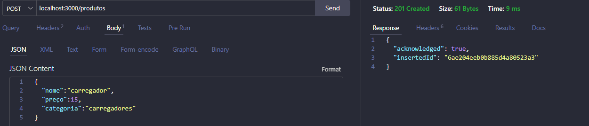
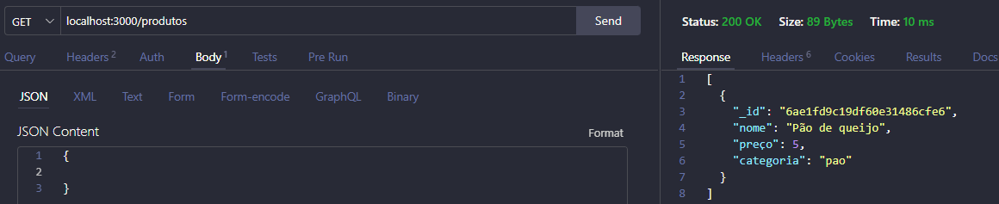
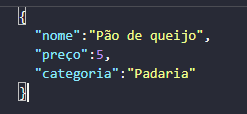
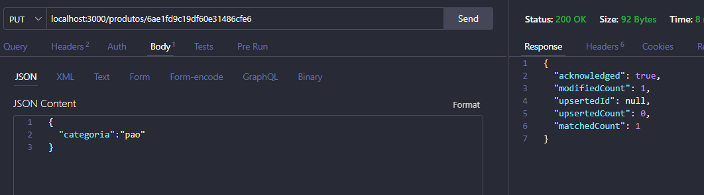
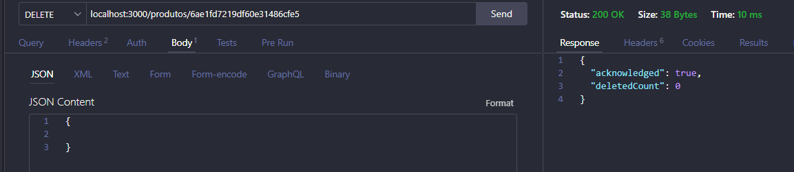

# API de Produtos: CRUD com Node.js e MongoDB

API REST simples para **cadastrar, listar, buscar, alterar e apagar produtos**, desenvolvida em **Node.js** com **Express** e o **driver oficial do MongoDB**.

Projeto didático da disciplina de **Banco de Dados**, para introduzir o conceito de banco de dados **não relacional (NoSQL)** e mostrar como uma API se comunica com um banco de dados.

Neste projeto, o banco é o **MongoDB Community Server**, instalado no próprio computador. Por isso a gente não precisa se preocupar com servidor externo nem com nada daquilo.

---

## Sumário

1. [Instalação](#1-instalação)
2. [Configurar o banco de dados](#2-configurar-o-banco-de-dados)
3. [Arquivo `.gitignore`](#3-arquivo-gitignore)
4. [Executar a API](#4-executar-a-api)
5. [Rotas da API](#5-rotas-da-api)
6. [Visualizar os dados](#6-visualizar-os-dados)
7. [Erros comuns](#7-erros-comuns)

---

## Tecnologias Usadas

| Tecnologia | Para que serve |
| --- | --- |
| Node.js (v20.6 ou superior) | Executa o JavaScript fora do navegador |
| Express | Cria o servidor e as rotas HTTP |
| MongoDB Node.js Driver | Conecta a API ao banco de dados |
| MongoDB Community Server | Banco de dados |
| Thunder Client ou Postman | Testa as requisições |

---

## Estrutura do projeto

```
api-mongodb/
├── .env            ← string de conexão com o banco (NÃO vai para o GitHub)
├── .gitignore
├── index.js        ← código da API
├── package.json
└── README.md
```

---

## 1. Instalação

Clone o repositório e instale as dependências:

```bash
git clone https://github.com/SEU_USUARIO/api-mongodb.git
cd api-mongodb
npm install
```

O `npm install` lê o `package.json` e baixa o `express` e o `mongodb` para a pasta `node_modules`.

> Se for criar o projeto do zero:

```bash
mkdir api-mongodb
cd api-mongodb
npm init -y
npm install express mongodb
```

---

## 2. Configurar o banco de dados

Como o MongoDB vai rodar local, a gente configura a URI no arquivo `.env`.

### MongoDB Community Server (local)

#### B1. Com instalador (precisa de administrador)

1. Acesse [mongodb.com/try/download/community](https://www.mongodb.com/try/download/community).
2. Escolha **Windows x64** e **msi**.
3. Na instalação escolha **Complete** e deixe marcados **Install MongoD as a Service** e **Install MongoDB Compass**.
4. O banco liga sozinho junto com o Windows.

#### B2. Com ZIP (sem administrador)

1. No mesmo site, escolha **Package: zip** e faça o download.
2. Extraia e renomeie a pasta para `C:\Users\SEU_USUARIO\mongodb`.
3. Crie a pasta de dados `C:\Users\SEU_USUARIO\mongodb-data`.
4. No PowerShell, ligue o servidor:

```powershell
& "$HOME\mongodb\bin\mongod.exe" --dbpath "$HOME\mongodb-data"
```

5. Espere aparecer `Waiting for connections` e **deixar essa janela aberta** — fechar a janela desliga o banco. Para rodar a API, abrir outro terminal.

### Arquivos `.env`

```
MONGO_URI=mongodb://127.0.0.1:27017
```

> **Usa `127.0.0.1` e não `localhost`.** porque o Node tenta primeiro o endereço IPv6 (`::1`), mas o MongoDB, por padrão, só escuta no IPv4. Com `localhost`, aparece o erro `ECONNREFUSED ::1:27017`.

### Criação do banco e da coleção

Não preciso criar nada antes. O banco **`loja`** e a coleção **`produtos`** são criados automaticamente no **primeiro POST**: o MongoDB cria o que faltar quando recebe o primeiro documento.

---

## 3. Arquivo `.gitignore`

```
node_modules
.env
```

- `node_modules`: são milhares de arquivos que o `npm install` recria a qualquer momento.
- `.env`: contém a string de conexão e **nunca** deve ir para o GitHub.

---

## 4. Executar a API

```bash
node --watch --env-file=.env index.js
```

| Opção | Função |
| --- | --- |
| `--env-file=.env` | Carrega a `MONGO_URI` do arquivo `.env` para `process.env` (Node 20.6+) |
| `--watch` | Reinicia o servidor sozinho ao salvar o `index.js` |

Saída esperada:

```
Conectado ao MONGODB
API rodando na porta 3000
```

---

## 5. Rotas da API

URL base: `http://localhost:3000`

| Método | Rota | Ação | Comando no MongoDB | Status |
| --- | --- | --- | --- | --- |
| `POST` | `/produtos` | Cadastra um produto | `insertOne` | 201 |
| `GET` | `/produtos` | Lista todos os produtos | `find().toArray()` | 200 |
| `GET` | `/produtos/:id` | Busca um produto pelo id | `findOne` | 200 |
| `PUT` | `/produtos/:id` | Altera os campos enviados | `updateOne` + `$set` | 200 |
| `DELETE` | `/produtos/:id` | Apaga um produto | `deleteOne` | 200 |

### POST /produtos

Requisição:

```json
{ "nome": "Mouse", "preco": 50, "quantidade": 5 }
```

Resposta (`201 Created`):

```json
{ "acknowledged": true, "insertedId": "6721a3f0c8e4b2a1d9f3e456", "insertedCount": 1 }
```



### GET /produtos

Resposta (`200 OK`):

```json
[
  { "_id": "6721a3f0c8e4b2a1d9f3e456", "nome": "Mouse", "preco": 50, "quantidade": 5 }
]
```



> A rota GET também pode ser testada direto no navegador: `http://localhost:3000/produtos`.

### GET /produtos/:id

```
GET http://localhost:3000/produtos/6721a3f0c8e4b2a1d9f3e456
```

Resposta (`200 OK`): um único objeto `{ }`, e não uma lista.



### PUT /produtos/:id

Requisição (só os campos que vão mudar):

```json
{ "preco": 80 }
```

Resposta (`200 OK`):

```json
{ "acknowledged": true, "matchedCount": 1, "modifiedCount": 1, "upsertedId": null, "upsertedCount": 0 }
```

- `matchedCount`: quantos documentos foram encontrados.

- `modifiedCount`: quantos documentos foram alterados (0 se o valor enviado já era o mesmo).



### DELETE /produtos/:id

Resposta (`200 OK`):

```json
{ "acknowledged": true, "deletedCount": 1 }
```



---

## 6. Visualizar os dados

| Banco | Ferramenta |
| --- | --- |
| Community Server | **MongoDB Compass** ou extensão **MongoDB for VS Code**, conectando em `mongodb://127.0.0.1:27017` |

No Compass, a barra **`>_ MONGOSH`**, na parte de baixo, abre um terminal do MongoDB:

```javascript
use loja
db.produtos.find()
db.produtos.find({ preco: { $gt: 30 } })
```

---

## 7. Erros comuns

| Mensagem | Causa provável | Solução |
| --- | --- | --- |
| `Cannot read properties of undefined (reading 'startsWith')` | A `MONGO_URI` não foi lida | Salvar o `.env`, conferir o nome da variável e rodar com `--env-file=.env` |
| `ECONNREFUSED ::1:27017` | Uso de `localhost` no banco local | Trocar por `127.0.0.1` |
| `ECONNREFUSED 127.0.0.1:27017` | O servidor local (`mongod`) não está rodando | Ligar o `mongod` (Opção B2) ou o serviço (Opção B1) |
| `Cannot GET /produtos` (404) | Erro de digitação na rota ou na URL | Comparar o caminho da rota com a URL |
| `BSONError` no GET, PUT ou DELETE por id | O id não é um ObjectId válido | Copiar o `_id` completo (24 caracteres) |
